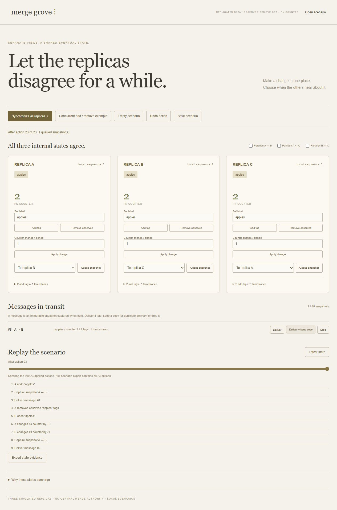

# Merge Grove

A deterministic replicated-state simulator. Three independent replicas maintain an observed-remove set and a PN counter while you control snapshot delivery, duplication, loss, and link partitions.



## Run

Requires Python 3.10+. No runtime dependencies or API keys.

```sh
python run.py --port 8000
```

Open http://127.0.0.1:8000/. Simulation runs locally in a browser worker. Save the scenario before refreshing; there is no network service or persistent database.

## Explore

- Add or remove labels independently at replicas A, B, and C.
- Apply signed counter changes at each replica and inspect positive/negative components.
- Queue immutable state snapshots, deliver them in any order, retain copies for duplicate delivery, or drop them.
- Partition links to block delivery while continuing local edits and queueing messages.
- Heal links and synchronize all replicas, or replay any earlier action with editing disabled.
- Inspect tagged additions, removal tombstones, full-state convergence, and portable scenario/evidence exports.

The initial example shares an apple tag with B, removes it at A, and concurrently adds a fresh apple tag at B. After synchronization, the new tag survives and the merged counter is 2. A later removal after observing both tags removes the visible label everywhere once delivered. [Saved example](docs/example.json) also includes a healed partition and duplicate delivery.

## Merge contract

The set stores `(replica:sequence, label)` additions and a set of removed tags. A removal observes the local tags for that label. Merge unions both collections, so an old snapshot cannot revive an already removed tag, while an unseen concurrent addition survives. Tombstones are deliberately retained; there is no garbage collection or membership-change protocol.

The PN counter stores three positive and three negative nondecreasing components. A replica updates only its own component. Merge takes componentwise maxima; the visible counter is the sum of positives minus negatives. Delivery duplication therefore cannot double-count an increment.

These state-based constructions follow the CRDT framework described by [Shapiro, Preguiça, Baquero, and Zawirski](https://www.lip6.fr/Marc.Shapiro/papers/2011/Comprehensive-CRDTs-RR7506-2011-01.pdf). Their merge operations are commutative, associative, and idempotent. Convergence requires dissemination of updates; permanent partitions or permanently lost updates can leave replicas different. The interface checks canonical full-state equality, which is stronger than equal currently visible labels and counter totals.

Snapshots capture sender state at send time. Later edits do not change queued messages. Deliver-and-keep retains the exact snapshot and ID for repeated delivery. Synchronize appends six send/deliver pairs over healed links; older queued messages remain in the queue. Replica-local mutation sequence counters are identity generators and are not themselves merged.

## Limits and files

Scenarios contain an `actions` array with at most 200 actions and 40 queued snapshots. Labels are trimmed, printable strings of 1–40 characters. Counter changes are nonzero integers from −100 to 100. Supported actions are `add`, `remove`, `increment`, `send`, `deliver`, `drop`, and `partition`; the example file documents their fields. Imports are limited to 100 KB and replay validated actions rather than trusting supplied replica state.

Save scenario exports the complete action history even while inspecting an earlier position. State evidence exports the selected replay position, all replica states, and pending snapshots. Undo/reset change simulated history; they are not rollback mechanisms for a live distributed service. This bounded educational implementation omits durable storage, real transport, replica replacement, authentication, and tombstone compaction.

## Verification

Requires Node.js 22+ for tests.

```sh
npm test
npm run check
python -m unittest discover -s tests -p 'test_*.py'
```

Ten JavaScript tests cover concurrent add/remove semantics, non-resurrection, duplicate delivery, snapshot immutability, partitions, PN-counter component merging, full-state equality, deterministic replay, malformed states/actions, and limits. Merge-law checks run over 300 generated histories and verify convergence after synchronization. One Python test checks static-server boundaries. CI runs on Linux and Windows.

Browser checks exercise convergence, blocked and duplicate deliveries, historical read-only replay, later observed removal, and scenario import/export. Independent Python replay verified all exported add tags, tombstones, counter components, local sequences, and the pending snapshot count.

`core.js` contains pure state transitions and merges; `worker.js` replays scenarios; `app.js` renders replicas, the network queue, and historical controls. Failed action batches leave the prior committed scenario intact.
